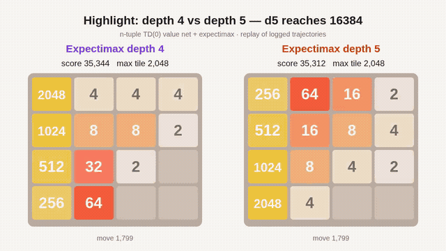

# 2048 Reinforcement Learning

A 2048 AI: an n-tuple network trained by afterstate TD(0), played with expectimax search. It started as a DQN project.

[](demo/expectimax/media/replay_s1_e1713.mp4)

*Eval game 1713 (seed-1 net): d5 reaches 16384 and scores 286,832. [Full 41 s video](demo/expectimax/media/replay_s1_e1713.mp4).*

| depth | mean score | ≥16384 |
|---|---|---|
| 1 | 104,943 | 0.05% |
| 2 | 138,191 | 1.80% |
| 3 | 162,093 | 14.85% |
| 4 | 178,842 | 24.50% |
| 5 | 195,259 | 36.00% |

*Values are the average of seed 1 and seed 2, computed from `results/ntuple/expectimax/summary.json`.* **Recommended: depth 4.**

All numbers come from committed result files, and each section names its source.

## Method

- **Value function:** an n-tuple network, which is a lookup-table linear approximator, not a neural net. It is trained by afterstate TD(0) with gamma 1, the game score as reward, alpha 0.0025 and greedy play. Each seed trains for 60 min on one core, about 1.23–1.26 M games (`results/ntuple/NTUPLE_RESULTS.md`).
- **Search:** exact expectimax. Chance nodes cover every empty cell (a 2 at 0.9, a 4 at 0.1), leaves use the n-tuple V(afterstate), and the only speed-up is a transposition table with no pruning. d is the number of player moves searched. d1 equals greedy play.
- The same 60-min snapshots are used at every depth, with no retraining.

## Detailed results

Source: `results/ntuple/EXPECTIMAX_RESULTS.md` and `results/ntuple/expectimax/summary.json`. Each arm plays fixed eval seeds from 1000: 1000 games for d1–d3, 200 for d4 and 100 for d5.

| seed | d | games | mean (95% CI) | median | ≥8192 | ≥16384 | ms/move |
|---|---|---|---|---|---|---|---|
| 1 | 1 | 1000 | 107,915 [105,388, 110,441] | 121,776 | 60.6% | 0.0% | 0.0009 |
| 1 | 2 | 1000 | 137,801 [136,026, 139,576] | 143,618 | 92.4% | 1.5% | 0.0238 |
| 1 | 3 | 1000 | 160,828 [157,894, 163,761] | 151,146 | 96.7% | 14.4% | 0.3836 |
| 1 | 4 | 200 | 178,812 [169,990, 187,635] | 162,142 | 96.5% | 24.5% | 5.0172 |
| 1 | 5 | 100 | 199,893 [185,428, 214,358] | 167,070 | 97.0% | 38.0% | 65.9220 |
| 2 | 1 | 1000 | 101,971 [99,341, 104,601] | 112,644 | 54.1% | 0.1% | 0.0009 |
| 2 | 2 | 1000 | 138,580 [136,667, 140,494] | 144,284 | 90.1% | 2.1% | 0.0261 |
| 2 | 3 | 1000 | 163,359 [160,338, 166,379] | 154,460 | 97.6% | 15.3% | 0.4166 |
| 2 | 4 | 200 | 178,872 [170,340, 187,404] | 157,178 | 98.0% | 24.5% | 5.4455 |
| 2 | 5 | 100 | 190,626 [176,605, 204,646] | 157,166 | 96.0% | 34.0% | 71.1732 |

No arm reached 32768. ms/move for d1–d3 was measured single-process over 100 games. For d4/d5 it was taken from the parallel eval itself (8 processes, nice 19, shared CPU), so treat it as an order of magnitude only.

**Paired differences** (same eval seeds, mean ± 1.96·sd/√n):

| comparison | seed 1 | seed 2 |
|---|---|---|
| d3 − d1 | +52,913 [+48,990, +56,836] | +61,388 [+57,395, +65,380] |
| d4 − d3 | +16,792 [+5,743, +27,841] | +13,666 [+2,748, +24,583] |
| d5 − d3 | +41,996 [+23,904, +60,087] | +24,898 [+8,145, +41,651] |
| d5 − d4 (seeds 1000–1099) | +25,008 [+4,430, +45,587] | +10,579 [−10,117, +31,275] |

Why d4 and not d5: d5 − d4 is not significant on seed 2, and d5 costs about 13× more time per move.

### The corner strategy is learned, not programmed

The training code (`ntuple/train.c`, `ntuple.h`, `common.h`) has no corner, monotonicity or empty-cell features and no reward shaping. Corner metrics exist only as diagnostics in the evaluators. Even so, the agent learns to keep its largest tile in a corner. The table shows seed 1, 1000 games per snapshot (`results/ntuple/NTUPLE_RESULTS.md` §3). "corner≥256" is the share of steps with the max tile in a corner once that tile is ≥256; a random policy scores 2.1%.

| training time | 5 s | 15 s | 30 s | 1 min | 8 min | 15 min | 60 min |
|---|---|---|---|---|---|---|---|
| mean score | 11,261 | 18,152 | 29,125 | 39,946 | 73,291 | 88,638 | 107,915 |
| corner≥256 | 0.4% | 8.3% | 46.6% | 60.4% | 74.1% | 80.8% | 84.0% |

## DQN history

Before n-tuple, the project tried many DQN variants (see the experiment branches). None reached the target of a mean above 15,000 with ≥1024 at 80% or more. The n-tuple player reached about 100k after 60 min on one core, so the project switched.

| round | tried | best mean | outcome | details |
|---|---|---|---|---|
| Baseline | original DQN + target net + PER checkpoint | 7,738 | reference | `results/baseline.md` |
| Step 2–3 | fixed DQN, one-hot + dueling, 3-step (15 min) | 2,449 (control A) | none near baseline | `results/compare/README.md` |
| Step 4 | 3 h active, arms A and C | 5,932 (arm A, 2-seed mean) | target missed | `results/step4/RESULTS.md` |
| Round 1 | afterstate, capacity/n-step, linear reward, conv2x2, restart pool | 10,349 (afterstate 180 min, s202) | all rejected; afterstate kept as control C | `results/experiments_STATUS.md`, `results/exp1_afterstate/EXTRA_afterstate.md` |
| Round 2 | ε = 0, replay ratio 0.25, value skip, vectorized target | 11,275 (R, s303) | all rejected | `research/round2/REPORT.md`, `results/round2/R_RESULTS.md` |
| Round 3 | gamma 1 + h(x) rescale, D4 symmetry, both | 12,317 (Y, s202) | all rejected | `results/round3_sym_gamma/ROUND3_RESULTS.md` |

## Legacy code

`main.py` (entry point, `train_DDQN`), `game_2048.py` (game and pygame UI) and `RL.py` (DQN agent) are the original project. Note that `python main.py` trains forever: `__main__` calls `train_DDQN` in a `while True` loop, so the GUI code after it never runs. The training curves of the original checkpoint `model/nn_prioritize_replay_no_invalid_gamma_099_2` show score, loss, turns and invalid-move ratio:


## Usage

Requires gcc on Linux (libc and libm only).

### n-tuple training
```bash
cd ntuple
nice -n 19 make && nice -n 19 make test   # or gcc -O3 -march=native -o X X.c -lm per program
nice -n 19 ./train 1 3600 snapshots       # SEED TOTAL_SECONDS OUTDIR
nice -n 19 ./eval snapshots/s1_t03600.bin 1000 1000 s1_t60.csv
```
`TOTAL_SECONDS` must be ≥ 5, because training stops at the last snapshot point, and snapshots (≈135 MB, not committed) are saved at 5 s … 60 min. The design is in `ntuple/NTUPLE_PREREG.md`. The helper scripts in `ntuple/` still contain absolute paths from the original machine.

### Expectimax evaluation
```bash
cd ntuple_expectimax
nice -n 19 gcc -O3 -march=native -o expectimax expectimax.c -lm
nice -n 19 ./expectimax path/to/s1_t03600.bin 4 1000 200 s1_d4.csv   # SNAPSHOT DEPTH SEED_START N OUT_CSV
python3 summarize.py          # rebuild the results tables
```
The reported runs used `run_all.sh` and `run_d45.sh`. Snapshot hashes are in `ntuple_expectimax/snapshots.sha256`.

### Demo
```bash
cd demo/expectimax && python3 build.py   # rebuilds expectimax_demo.html
```
`demo/expectimax/expectimax_demo.html` is an offline page. It shows result charts and four replayed games (s1 eval 1813, 1713, 1364 and s2 eval 1523), each switchable between d1, d3, d4 and d5. These games lie outside the d4/d5 statistics range. The video above is in `demo/expectimax/media/` and is rendered by `record_replay.js` (Playwright + ffmpeg).

DQN training and evaluation: check out `exp/round3-sym-gamma` and run `python main.py train --help` / `python eval.py --help`.

## Directory structure (this branch)

```
├── main.py, RL.py, game_2048.py   original DQN + pygame game (legacy)
├── model/, result/                 original DQN checkpoint and training plot
├── ntuple/                         n-tuple TD(0) training (train.c), eval, tests, Makefile, PREREG
├── ntuple_expectimax/              expectimax search (expectimax.c), n-tuple headers, eval.c,
│                                   run scripts, summarize.py, snapshots.sha256
├── results/ntuple/
│   ├── NTUPLE_RESULTS.md           n-tuple TD training results (seeds 1 and 2)
│   ├── EXPECTIMAX_RESULTS.md       expectimax d1–d5 results and paired CIs
│   ├── expectimax/                 summary.json, summary_table.md, logs, timing
│   └── rerun_s2/                   seed 2 rerun logs and eval summary
├── demo/expectimax/                offline HTML demo, build script, replays, screenshots
└── PROGRESS.md                     run log for this branch
```

## Branches

| branch | content |
|---|---|
| `main` | original project (legacy DQN) |
| `dqn-revamp` | DQN rewrite (FastBoard, eval.py, CLI), baseline, steps 2–4 |
| `exp/integrate` | round 2 integration, C/E/R results |
| `exp/round3-sym-gamma` | round 3 G/Y/GY, latest DQN code |
| `exp/ntuple-results` | n-tuple TD results |
| `exp/ntuple-expectimax` | **this branch**: expectimax, demo |

Other branches (`s3-*`, `exp/afterstate*`, `exp/replay-nstep`, `exp/linear-reward`, `exp/conv2x2`, `exp/restart-pool`, `exp/eps-episode`, `exp/active-clock`, `exp/qtd-analysis`, `research/round2`, `exp/round2-vectorize`, `exp/round2-skip`) hold the individual DQN experiments summarized above.
