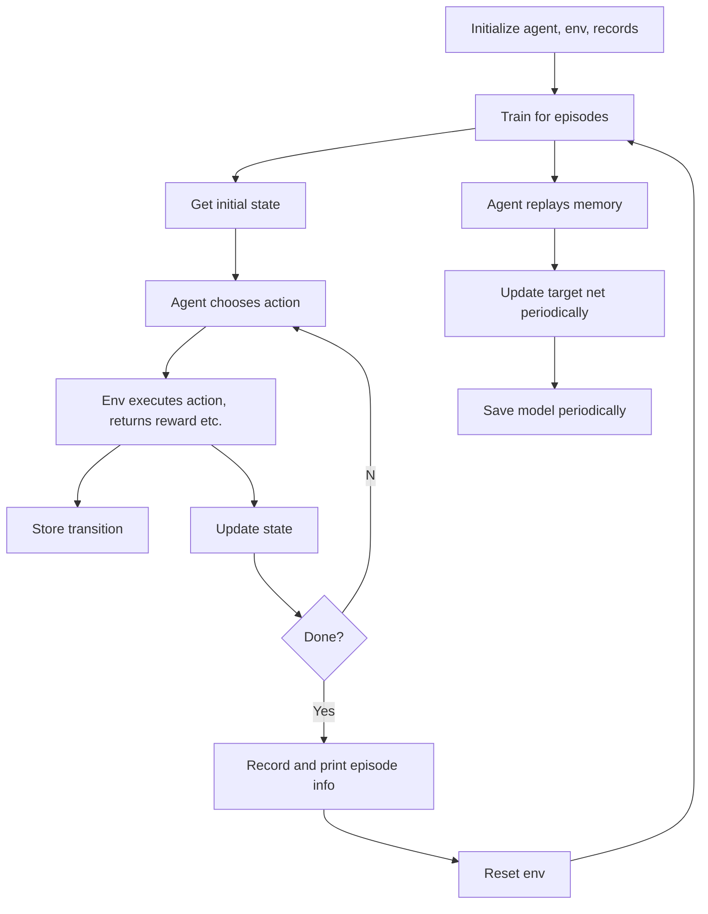
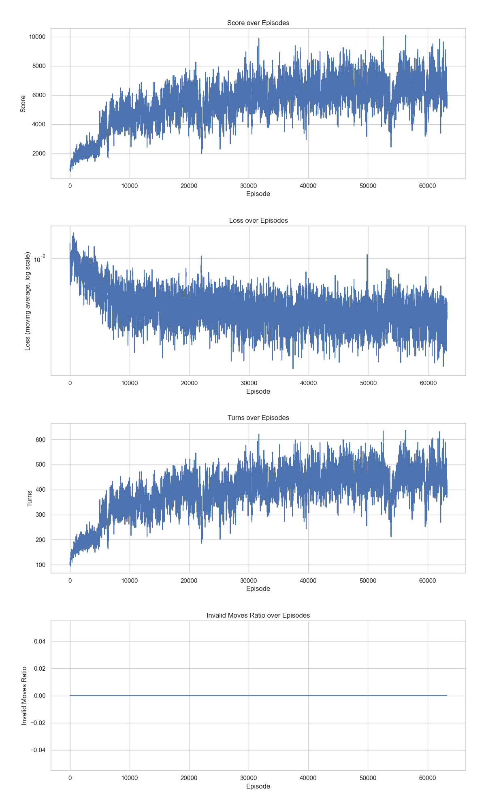

# 2048 Reinforcement Learning Project

This project consists of a 2048 game implementation and a program that trains a game AI using reinforcement learning.

## Contents

- `main.py`: The main entry point of the application. This file contains the code to start the game and train the AI.
- `game_2048.py`: The implementation of the 2048 game, including the game logic and the UI interface.
- `RL.py`: The implementation of the reinforcement learning. This file contains the code to train the AI.

## How to Run the Game

Run `main.py` to start the game. The goal of the game is to slide the number blocks on a 4x4 grid. Each slide randomly generates a 2 or 4 in an empty position. When two blocks with the same number collide, they merge into their sum. The game ends when the board is filled with numbers and no valid moves can be made.

```bash
python main.py
```
## Flow

## Results

Here are the results of the training process:



This plot contains four subplots showing the game score, loss, game turns, and game invalid turn ratio, respectively, as the training progresses.

## How to Train the AI

If you wish to train your own AI, you can run the `train_DDQN` function in `main.py`. This will train the AI using reinforcement learning.

```bash
python main.py
```

Note that the training process might take some time and will vary depending on the performance of your system.

## Lessons Learned

While developing this project, a few key lessons were learnt:

- Removing invalid moves helped in reducing the action space, thereby making the AI training process more efficient.
- An excessively high initial learning rate and a wrong optimizer can easily lead to hitting the boundary. It's crucial to monitor the loss during the training process.
- The size of epsilon in the reinforcement learning process is an important parameter.
- By fixing the random seed at the beginning, the training process can be made deterministic and reproducible.

---

Here is the AI in action:


---

## dqn-revamp: training & evaluation

The `dqn-revamp` branch introduces a high-performance simulation board (`FastBoard`), corrected Double DQN learning dynamics with Prioritized Experience Replay (PER), headless evaluation and benchmarking tooling, and a unified CLI.

### Setup

Create and activate a virtual environment, then install dependencies:

```bash
python -m venv .venv
source .venv/bin/activate
pip install torch --index-url https://download.pytorch.org/whl/cpu
pip install -r requirements.txt
```

### Training (`main.py train`)

Train a DDQN agent using the fast CPU board. By default, training fine-tunes from the baseline checkpoint `model/nn_prioritize_replay_no_invalid_gamma_099_2` and saves to a new timestamped checkpoint `model/dqn_revamp_<timestamp>`, ensuring baseline weights are never overwritten.

```bash
# Fine-tune from baseline checkpoint (default)
python main.py train

# Train from scratch without loading any checkpoint
python main.py train --from-scratch

# Specify custom output checkpoint and time limit
python main.py train --save-as model/my_model.pt --minutes 15
```

Supported training flags:
- `--checkpoint CHECKPOINT`: Input model checkpoint to load (default: `model/nn_prioritize_replay_no_invalid_gamma_099_2`).
- `--from-scratch`: Start training with randomly initialized weights instead of loading a checkpoint.
- `--save-as SAVE_AS`: Destination path for the output checkpoint (default: `model/dqn_revamp_<timestamp>`).
- `--minutes MINUTES`: Time limit in minutes for the training run.
- `--episodes EPISODES`: Maximum number of training episodes (default: `1000000`).
- `--threads THREADS`: PyTorch CPU threads to use (default: `1`, optimal for fast single-position batches).
- `--seed SEED`: Random seed for reproducible training.
- `--log LOG`: Path to output CSV episode metrics (default: `results/train_<output name>.csv`; also writes a JSON summary `<log>.json`).
- `--gamma GAMMA`: Discount factor $\gamma$ (overrides `DQNConfig.gamma`).
- `--replay-every REPLAY_EVERY`: Frequency of replay updates per environment step (default: `4`).
- `--save-every SAVE_EVERY`: Interval in episodes between periodic checkpoint saves (default: `250`).
- `--plot`: Generate training curve plot saved to `<log>.png`.

### Playing GUI (`main.py play`)

Launch the interactive Pygame GUI using an agent checkpoint:

```bash
# Launch GUI with default checkpoint
python main.py play

# Launch GUI with a specific checkpoint
python main.py play --checkpoint model/dqn_revamp_<timestamp>
```

### Headless Evaluation (`eval.py`)

Run deterministic, headless evaluations on greedy DQN or random policies without requiring a display:

```bash
# Evaluate baseline checkpoint across 100 fixed seeds (1000-1099)
python eval.py --checkpoint model/nn_prioritize_replay_no_invalid_gamma_099_2 --games 100 --seed-start 1000 --board fast

# Evaluate random baseline
python eval.py --policy random --games 100 --seed-start 1000 --board fast
```

Evaluation options:
- `--checkpoint CHECKPOINT`: Checkpoint to evaluate (default: `model/nn_prioritize_replay_no_invalid_gamma_099_2`).
- `--policy {greedy,random}`: Action selection policy (default: `greedy`).
- `--games GAMES`: Number of evaluation games (default: `100`).
- `--seed-start SEED_START`: Initial seed for consecutive games (default: `1000`, running seeds `1000` to `1099`).
- `--board {fast,old}`: Environment implementation (`fast` for `FastBoard`, `old` for legacy `Board`; default: `fast`).
- `--max-steps MAX_STEPS`: Maximum moves allowed per game (default: `5000`).
- `--json JSON`: Optional path to output full per-game evaluation records and statistics in JSON.

Output metrics include:
- Score metrics: mean, median, max score.
- Reach rates: percentage of games reaching tiles $\ge 512$, $\ge 1024$, $\ge 2048$, and $\ge 4096$.
- Max-tile distribution: breakdown of terminal highest tile achieved across games.

### Simulation Benchmark (`bench.py`)

Benchmark the step throughput (action legality check, valid move selection, and state transition) between the legacy board and the fast numpy board:

```bash
python bench.py --seconds 10
```

`FastBoard` achieves ~24x speedup over the legacy `Board` (~127k steps/s vs ~5.2k steps/s) by eliminating per-step board deepcopies and keeping legal move queries pure (RNG-free).

### Running Tests (`pytest`)

Execute the complete test suite:

```bash
pytest -q tests/
```

Tests cover:
- Differential equivalence between `FastBoard` and legacy `game_2048.Board` (20,000 random boards, 500 synchronized games).
- Step-2 RL fixes (Double DQN masking, PER IS weights, SumTree stability, linear Q output).
- CLI training and headless evaluation smoke tests.

### Step-2 Core RL Fixes

- **Linear Q output**: Removed non-linear activation from the final layer (`fc3`) of `DQN`, allowing output Q-values to model unbounded real values.
- **Double DQN with masked targets**: During target computation, action selection is performed by the online network restricted to valid moves (`masked_fill(~masks, -torch.inf)`), while the target network evaluates the Q-value for that action. Fully terminal / all-invalid states cleanly bootstrap to zero.
- **PER IS weights (beta $0.4 \to 1.0$)**: Prioritized Experience Replay incorporates importance sampling weights into the TD loss to correct sampling bias, with $\beta$ linearly annealed from `0.4` to `1.0` over `per_beta_anneal_steps` (100,000) updates.
- **Gamma from `config.py`**: Discount factor $\gamma$ is centralized in `DQNConfig.gamma` in `config.py` (default `0.99`) and configurable via `--gamma`, eliminating hardcoded replay values.
- **CLI model path & safe defaults**: Structured CLI in `main.py` allowing explicit `--checkpoint` loading and `--save-as` paths; fine-tuning defaults never overwrite baseline checkpoint weights.
